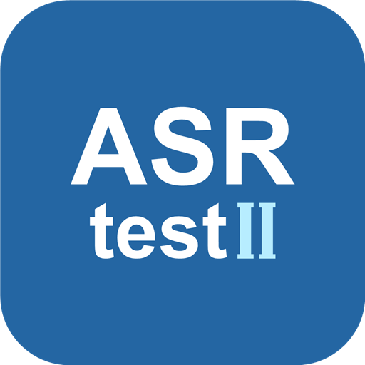

<p align="center"></p>

<h1 align="center">ASRtestII</h1>
<p align="center">在Android设备上录音或导入WAV，按时间和说话人查看转写，再按需生成勘误稿和分点摘要。</p>
<p align="center">
  <a href="./app/AndroidManifest.xml"></a>
  <a href="./app/jni/arm64-v8a"></a>
  <a href="https://github.com/Roylyl/ASRtestII/releases"></a>
</p>

## 快速开始

1. 在Android 8.0或更新的64位ARM设备上，从[发行页](https://github.com/Roylyl/ASRtestII/releases)选择正式版本，下载并安装与标签对应的APK，例如`V1.0.0`的附件是`ASRtestII-1.0.0.apk`。安装包内置语音和说话人模型，首次使用请预留存储空间。
2. 打开“测试”，点击“开始识别”并允许麦克风权限，或者点击“导入WAV/ZIP”选择已有录音。长文件处理时会先显示即时文字，再按时间追加分人结果。归组完成后以最终编号为准。
3. 需要勘误或摘要时，在“设置→云端模型”填写兼容Chat Completions的服务地址、API Key和模型名称。回到测试页点击“开始勘误并总结”。已有按时间和说话人保存的勘误稿，也可以直接打开TXT并重新生成摘要。

语音识别、分段和声纹提取均在本机运行。只有主动开始勘误或摘要时，应用才向配置的云端服务发送转写文字和说话人标签。录音和声纹不会随这些请求上传。API Key使用Android Keystore加密后保存在本机。

## 识别与摘要

|功能|使用方式|
|---|---|
|录音与文件转写|X-ASR1920ms支持中英文转写。WAV可单独导入，也可通过ZIP批量导入。结果按“[起止时间]说话人：内容”显示。|
|语音分段与说话人区分|设置页可选Silero、TEN或FSMN VAD。使用pyannote切分连续发言，使用CAM++或ERes2NetV2提取声纹。短答和重叠处可能无法可靠归属。|
|声纹与热词|在“声纹”页登记、命名声纹或调整阈值。在“热词”页选择领域词包、添加自定义词，并分别调整权重。|
|勘误与分点摘要|勘误保留时间和说话人，只修改有上下文依据的文字。摘要按话题整理问答、经历和要点。默认提供DeepSeek Flash配置，也支持手动选择其他兼容服务。|

文件格式、模型设置与声纹登记详见[使用说明](./使用说明.md)。

## 应用内更新

应用每次启动会检查GitHub上的正式发行版，之后按30分钟周期检查。Android休眠、断网或限制后台运行时，后台检查可能延后。也可以随时在“设置”最底部点击“检查更新”。如果GitHub API限流，应用会尝试从官方发行页查找与发行标签对应的APK附件。

发现新版后，弹窗会显示版本、更新说明和附件大小。点击“下载更新”可以查看进度，选择“后台下载”可以继续使用应用。下载完成后，应用核对安装包、版本和签名，并在前台打开Android系统安装器。若下载在后台完成，可点击通知或回到应用继续安装。首次安装可能需要允许ASRtestII安装未知来源应用，最终安装由用户在系统界面确认。

## 从源码构建

需要Windows、PowerShell 7、JDK 17、Android SDK和Git LFS。将`JAVA_HOME`指向JDK，`ANDROID_HOME`指向安装了Android平台和Build Tools的SDK。仓库包含构建使用的Kotlin编译器、JNI库和模型清单，模型权重通过Git LFS分发。

```powershell
git lfs install
git clone https://github.com/Roylyl/ASRtestII.git
cd ASRtestII
git lfs pull
pwsh -File .\Build-Apk.ps1 -Unsigned
```

该命令在Windows桌面生成`ASRtestII-1.0.0-unsigned.apk`（版本号取自`versionName`）。如需直接安装，使用自己的密钥构建签名包：

```powershell
pwsh -File .\Build-Apk.ps1 -Keystore "D:\keys\release.p12" -KeyAlias "release"
```

默认签名产物按`ASRtestII-版本号.apk`命名，例如Windows桌面上的`ASRtestII-1.0.0.apk`。可用`-OutputApk`指定其他输出路径。覆盖安装已发布版本需要相同的签名证书。

## 发布新版本

1. 更新[AndroidManifest.xml](./app/AndroidManifest.xml)里的`versionName`和`versionCode`。例如从`1.0.0`升级到`1.0.1`时，同时递增`versionCode`。
2. 用原发行证书构建安装包，在Windows桌面找到对应版本的APK。
3. 在GitHub创建正式Release，标签使用`V1.0.1`这样的三段数字格式，填写更新说明，并把桌面的`ASRtestII-1.0.1.apk`作为该版本的发行附件上传。应用比较版本数字，并跳过草稿和预发布版本。

第三方模型与运行库说明见[模型许可目录](./app/assets/licenses/)及[FSMN模型说明](./app/assets/fsmn/NOTICE.txt)。
